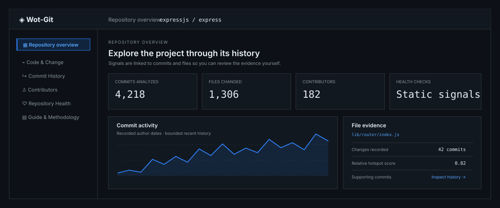
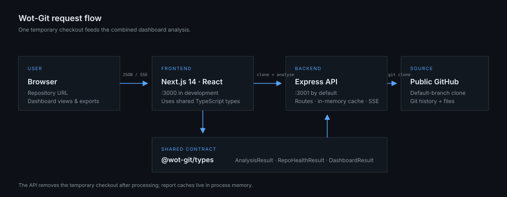

<div align="center">



# Wot-Git

### Explore a repository through its Git history

Wot-Git turns public repository history and recognizable project files into a practical, inspectable report. Use it to orient yourself in an unfamiliar codebase, find files worth investigating, and follow each signal back to the commits and repository evidence behind it.

[Get started](#run-locally) · [How it works](#how-it-works) · [Limitations](#important-limitations)

</div>

---

## What Wot-Git helps you explore

Wot-Git is designed for developers joining an unfamiliar project, maintainers reviewing activity patterns, and contributors deciding where to begin exploring. It gives a compact view of repository history without requiring users to install an analysis agent into the repository.

- **Change patterns:** frequently changed files, relative hotspots, co-changed paths, and activity over time.
- **Commit context:** commit sizes, subjects, author identities, and files associated with keyword-matched bug-fix commits.
- **Repository signals:** README, recognizable tests and test configuration, CI, Docker configuration, tracked environment files, and limited secret-pattern checks.
- **Evidence-first exploration:** inspect a file’s recorded commits, change counts, contributors, and related files; export the report data for further review.

These are calculated indicators and static checks. They help you decide what to inspect; they do not establish that a file is defective or that a repository is healthy.

## Product tour

The dashboard visual above is an illustration; its displayed values are examples, not results from a repository scan.

The dashboard starts with **Repository Overview** and the repository README when one can be read. From there, use the existing views:

| Area | What it shows |
|---|---|
| Overview | Repository README, summary signals, active files and contributors, and report export |
| Code & Change | Hotspots, file churn, co-change pairs, and source outline |
| Commit History | Bug-fix-associated files, commit activity, commit sizes, and commit log |
| Contributors | Recorded Git author identities per file |
| Repository | Static Health checks and monthly history |
| Guide | Interpretation, calculations, FAQs, usage terms, and data/privacy details |

### How to use it

1. Enter a public GitHub URL such as `https://github.com/expressjs/express`, or a short `owner/repo` name.
2. Wait for the dashboard to clone the repository and prepare the bounded analysis. The progress view reports the current scan stage.
3. Start with Overview, then follow a file or contributor signal into the relevant analysis view.
4. Open **Inspect** to see supporting file-level history. Use the linked commits and the repository’s own tests to verify anything important.
5. Export a CSV for the active analysis view or a concise Markdown report from Overview.

## How it works

Wot-Git uses a pnpm workspace with a Next.js web app, an Express API, and a shared TypeScript types package. The dashboard request clones the repository once, runs Git-history analysis and static Health checks against that temporary checkout, reads the README overview, and returns a combined report.



### Analysis at a glance

- **Churn** counts how often a file appears in the included commit history; it is not changed lines.
- **Hotspot** averages the file’s normalized churn and normalized current byte size relative to other included files.
- **Bug Files** lists files changed by commits whose subject contains a whole-word match for one of the configured English keywords: `fix`, `bug`, `defect`, `error`, `issue`, `patch`, `repair`, `resolve`, `close`, or `crash`.
- **Ownership** reports Git author email identities from commit metadata. A single-author flag means only one identity was recorded in the bounded history; it does not prove current ownership.
- **Health** scores the presence of recognized static project signals. It does not install dependencies, run tests, build the project, or certify security.

See the in-app **Guide & Methodology** for calculation details and examples. The code-level handoff is in [`docs/PROJECT_CONTEXT.md`](docs/PROJECT_CONTEXT.md).

## Important limitations

Wot-Git is a decision-support and repository exploration tool, not a bug detector or a code-quality guarantee.

- A commit message can be incomplete or misleading. Bug Files is a keyword heuristic and may miss fixes or associate unrelated changes.
- Hotspot, churn, co-change, and ownership values describe observed Git history. They are clues to investigate, not proof of risk, coupling, expertise, or defects.
- Health checks detect recognizable file names, paths, and a small set of text patterns. Finding test files does not show that tests pass or provide good coverage.
- Secret scanning examines a limited set of text/config files in the current revision only. It can miss secrets and produce false positives; matched values are redacted from the response. It does not scan historical contents.
- Results are limited to the submitted public GitHub repository and the clone’s default branch. Wot-Git does not analyze uncommitted work or automatically include the contents of other repositories referenced by submodules.
- Unusual project conventions, renames, generated files, and unsupported source syntax can make signals incomplete.

### Scan limits

Current defaults are deliberately bounded. A report may be marked as partial when a history or file-detail cap is reached; clone/scan timeouts or the checkout size limit can stop a scan.

| Limit | Current value |
|---|---:|
| Clone timeout | 60 seconds |
| Total scan deadline | 3 minutes |
| Git-history depth requested | 10,001 commits to detect a cap |
| Commits included in analysis | 10,000 |
| Checkout size | 1 GiB |
| Distinct file paths in history metrics | 10,000 |
| Included paths per commit | 100 |
| Distinct authors retained per file | 100 |
| Co-change pairs retained / returned | 100,000 / 200 |
| Outline files / maximum file size | 300 / 500 KiB |
| README display size | 256 KiB |

The implementation is authoritative for the precise coverage flags. See [`apps/api/src/config/limits.ts`](apps/api/src/config/limits.ts) and the [technical handoff](docs/PROJECT_CONTEXT.md).

## Run locally

### Requirements

- Node.js (the repository does not currently declare a supported Node version range)
- pnpm 11.x, as used by the current workspace
- Git available on `PATH`

### Install and start

```bash
pnpm install
pnpm dev
```

The web app runs at `http://localhost:3000`; the API defaults to `http://localhost:3001`. The web API URL can be changed with `NEXT_PUBLIC_API_URL`; the API port can be changed with `PORT`.

Run only one app if needed:

```bash
pnpm dev:web
pnpm dev:api
```

Build and check the current test suite:

```bash
pnpm build
pnpm --filter @wot-git/api test
pnpm --filter @wot-git/api benchmark
```

The benchmark uses a small manually labeled fixture. Its results are fixture-specific and are not general accuracy claims.

## API

The local API base URL is `http://localhost:3001`.

| Method | Endpoint | Purpose |
|---|---|---|
| `GET` | `/health` | API process status |
| `POST` | `/analyze` | Git-history analysis only |
| `POST` | `/repo-health` | Static repository Health checks only |
| `POST` | `/dashboard` | Combined analysis, Health, and README Overview response |
| `POST` | `/dashboard/stream` | Combined dashboard response with server-sent progress events |

Analysis endpoints accept JSON like:

```json
{
  "repoUrl": "https://github.com/expressjs/express"
}
```

To bypass the cache, send `"refresh": true` in the JSON body. The combined dashboard and Health caches live for up to 6 hours; the standalone `/analyze` cache lives for up to 24 hours. They are in-memory caches and are cleared when the API process restarts.

## Privacy and repository handling

The API clones repositories to a temporary directory and removes the checkout after analysis. It stores no persistent user account or repository database in the current implementation. Analysis results are temporarily cached in API process memory according to the lifetimes above. Repository search suggestions are requested directly from GitHub’s public search API by the browser.

Only public GitHub repositories are supported. Do not submit private credentials or other sensitive data. The project does not include a deployment configuration, so data handling for any future hosted deployment will depend on the operator’s infrastructure and must be documented separately.

## Project status

Wot-Git is an actively developed project. The current repository contains API tests, a small offline signal benchmark, and a production buildable web dashboard. The benchmark is not a large-scale accuracy study; results should be validated against real developer tasks before being treated as an effectiveness claim.

### License

**No `LICENSE` file is currently present in this repository.** The project owner intends to make Wot-Git available for free, but the redistribution and reuse terms have not yet been specified in the codebase. Add a license before describing the source as open source or granting reuse rights.

### Feedback

Report issues or suggest improvements on the [Wot-Git issue tracker](https://github.com/KayHo412/Wot-Git/issues).
